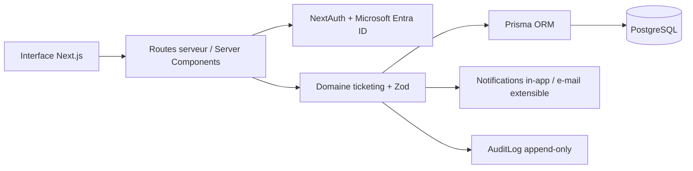
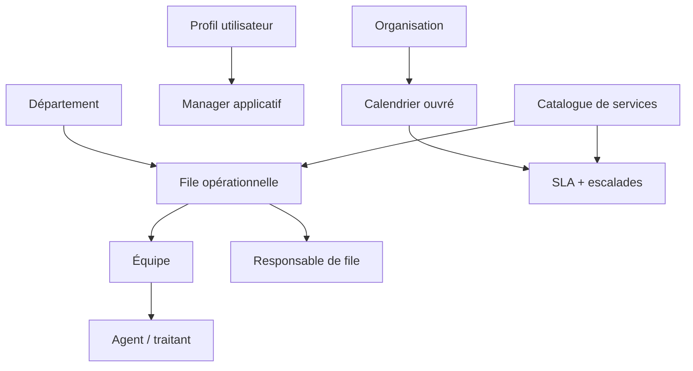
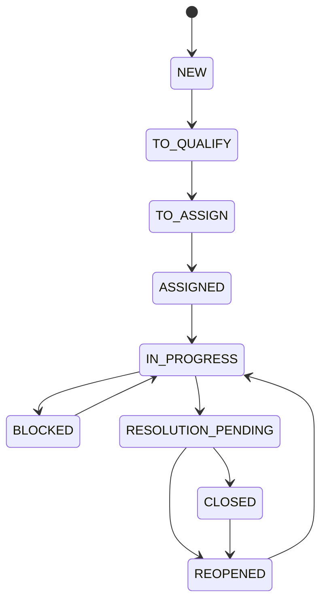

# Architecture validée — Ticketing interne

## 1. Architecture générale

Les contrôles d’accès sont appliqués dans les services serveur et les handlers API. L’interface ne constitue jamais une frontière de sécurité.

## 2. Organisation métier

Le manager hiérarchique Entra ID du demandeur est une relation distincte du
manager applicatif choisi dans `/admin/users` et du responsable de file. Le
catalogue est l’unique source de routage : un demandeur ne transmet pas
directement un ticket à une file.

## 3. Modèle relationnel

Les éléments opérationnels ne sont pas stockés dans un tableau JSON du ticket.

| Domaine | Tables principales |
|---|---|
| Identité | `User`, `Account`, `Session`, `Department`, `EntraDepartmentMapping`, `UserProfileChange` |
| Organisation | `Organization`, `Department`, `Queue`, `Team`, `TeamMember`, `Role`, `Permission`, `PermissionScope`, `UserRole` |
| Catalogue | `ServiceCatalogItem`, `SLA`, `BusinessCalendar`, `Holiday`, `EscalationRule` |
| Ticket | `Ticket`, `TicketMessage`, `TicketAssignment`, `TicketEvent`, `Attachment` |
| Sécurité | `TicketAccess`, `AuditLog` |
| Notification | `Notification`, `NotificationRule` |

Les suppressions sensibles sont protégées par `Restrict`, les historiques utilisent des tables dédiées et les indexes couvrent le demandeur, la file, l’agent, le statut et l’échéance SLA.

## 3 bis. Deux espaces applicatifs

L’application expose deux espaces fonctionnels sans layout partagé :

| Espace | Routes | Utilisateurs | Protection |
|---|---|---|---|
| Normal | `/dashboard`, `/tickets`, `/inbox`, `/queues`, `/reporting` | Demandeur, agent, responsable, lecteur reporting | Layout utilisateur et permissions métier serveur |
| Administration | `/admin`, `/admin/users`, `/admin/departments`, `/admin/queues`, `/admin/teams`, `/admin/catalog`, `/admin/sla`, `/admin/notifications`, `/admin/tickets`, `/admin/audit`, `/admin/reporting` | Administrateur fonctionnel ou technique global | `app/admin/layout.tsx` puis contrôle fonctionnel/technique dédié |

L’administrateur technique n’obtient pas les pages fonctionnelles ni un accès implicite aux tickets confidentiels. Les pages et les API d’administration revalident le rôle côté serveur ; masquer un lien dans la navigation ne constitue jamais une protection.

La page historique `/audit` redirige vers `/admin/audit` afin de conserver la compatibilité sans maintenir une seconde interface d’audit dans l’espace normal.

## 3 ter. Provisioning et fiche utilisateur

Microsoft Entra ID reste l’unique fournisseur d’authentification. Lors de la
première connexion, `syncUserFromEntraProfile` conserve l’identifiant unique,
l’e-mail, `entraDisplayName`, le département brut et le manager hiérarchique
source (`entraManagerId`, `entraManagerObjectId`, nom et e-mail). Le statut par
défaut en base est `PENDING_ASSIGNMENT`, ce qui protège aussi la courte période
entre la création Prisma par Auth.js et la synchronisation Graph.

Une adresse présente dans `ADMIN_EMAILS` constitue une exception de bootstrap
contrôlée par l’environnement : après une authentification Entra ID réussie,
la ligne `User` réelle est activée et reçoit le rôle global
`FUNCTIONAL_ADMIN`. Elle n’est jamais créée par le seed. Les rôles et le
catalogue de permissions sont installés par une migration Prisma idempotente.

L’administrateur fonctionnel gère les valeurs internes `managedDisplayName`,
`departmentId`, `managerId`, `primaryRoleCode`, `primaryTeamId`,
`authorizedQueueId` et `status` via `PATCH /api/admin/users/[id]`. Le handler
revalide `requireAdminAccess("FUNCTIONAL")`; l’e-mail et l’identifiant Entra ne
font pas partie du schéma de mutation. Chaque modification crée une ligne
`UserProfileChange`, un `AuditLog` avant/après et, lorsque le périmètre ou le
statut est impacté, une notification applicative.

Les pages normales refusent `PENDING_ASSIGNMENT` et redirigent vers
`/pending-assignment`. `/profile` expose ensuite le nom, le département, le
manager applicatif, l’équipe et la file en lecture seule. La file autorisée
borne le routage, les listes, la prise en charge et le traitement des tickets ;
les relations Entra, applicative et responsable de file ne sont jamais
réutilisées comme si elles représentaient la même responsabilité.

## 4. Matrice des rôles

| Rôle | Portée | Droits essentiels |
|---|---|---|
| Demandeur | Ses tickets | Créer, lire, commenter publiquement, confirmer ou refuser une résolution |
| Agent / traitant | Files, équipes ou périmètres attribués | Lire et traiter, commenter en interne, faire avancer le workflow |
| Responsable de file | Files autorisées | Superviser, affecter, suivre la charge, escalader |
| Administrateur fonctionnel | Périmètre de configuration | Départements, files, équipes, rôles, catalogue, SLA, audit |
| Administrateur technique | Configuration technique explicitement autorisée | Configuration technique ; aucun accès automatique aux dossiers sensibles |
| Lecteur de reporting | Indicateurs autorisés | Lecture seule des statistiques cloisonnées |

Une permission peut être globale ou limitée à un département, une file, une équipe, un portefeuille ou une liste nominative via `PermissionScope`.

Les codes fonctionnels existants sont `REQUESTER`, `AGENT`, `QUEUE_MANAGER`,
`FUNCTIONAL_ADMIN`, `TECHNICAL_ADMIN` et `REPORTING_READER`. Ils correspondent
respectivement à DEMANDEUR, AGENT/TRAITANT, RESPONSABLE_DE_FILE,
ADMINISTRATEUR_FONCTIONNEL, ADMINISTRATEUR_TECHNIQUE et LECTEUR_REPORTING.
Le code historique `ADMIN` n’existe pas dans le schéma actuel ; aucune donnée
à migrer vers `FUNCTIONAL_ADMIN` n’a donc été trouvée.

Le département interne n’est jamais affecté automatiquement à partir d’une
valeur Entra. `User.entraDepartmentValue` et sa clé normalisée sont conservés,
un utilisateur ordinaire passe à `PENDING_ASSIGNMENT`, puis l’administrateur
choisit explicitement `departmentId` dans `/admin/users`. La validation produit
un `AuditLog` avant/après et l’historique dédié `UserProfileChange`. Le
bootstrap `ADMIN_EMAILS` ne donne que l’accès à la console d’administration ;
il ne fabrique pas un département, une file ou une équipe.

`User.administrativelyDisabled` conserve une désactivation décidée dans
l’application et empêche une synchronisation Entra de réactiver silencieusement
le compte. La valeur officielle du département n’est jamais éditable depuis
`/admin/users`.

## 5. Workflow et règles obligatoires

- `BLOCKED` exige un motif et un détail ; la suspension SLA est gérée explicitement.
- `RESOLUTION_PENDING` exige la cause, l’action réalisée et la solution ; l’action préventive est conservée si fournie.
- `REOPENED` exige un motif.
- Une affectation enregistre l’auteur, l’ancien agent, le nouvel agent, la date, un événement et une notification.
- Une réorientation de file doit ajouter un événement sans remettre les échéances SLA à zéro.

## 6. Routage obligatoire par catalogue

Lorsqu’un demandeur crée un ticket :

1. l’identité et le département viennent de la session Entra ID ;
2. le demandeur choisit un `ServiceCatalogItem` actif ;
3. le type, la catégorie, la file, la priorité, le SLA et les règles d’escalade sont lus depuis ce service ;
4. le demandeur ne peut transmettre ni `departmentId`, ni `queueId`, ni `assignedToId` dans la création ;
5. le service peut être rattaché au département du demandeur ou à un autre département ;
6. la hiérarchie de traitement reste Département → File → Équipe → Responsable de file → Agent ;
7. le responsable de file reçoit la notification et l’affectation respecte les membres actifs de ses équipes.

Le test de routage strict et l’algorithme d’auto-attribution sont dans `tests/routing.test.ts`.

## 7. SLA et exploitation

`SLA` définit les délais de première réponse et de résolution, le calendrier et les seuils 50/80/100 %. `Organization` porte le périmètre de gouvernance, tandis que `BusinessCalendar` contient les jours ouvrés, les horaires, le fuseau et les jours fériés d’une organisation active. Les modes `ROLLING`, `ABSOLUTE` et `RELATIVE_MILESTONE` sont pris en charge par `lib/sla.ts`.

`/api/jobs/sla-monitor` est prévu pour Vercel Cron. Il crée des événements et notifications idempotents par seuil, puis alerte le responsable et l’agent affecté.

## 8. Cloisonnement et audit

Les listes, recherches, filtres, reporting et suggestions doivent réutiliser les mêmes prédicats de visibilité. La file permet de filtrer les tickets non affectés, affectés à l’utilisateur, de son équipe, urgents, proches ou dépassant leur SLA, par statut, priorité, département et file autorisés. `canViewTicket` refuse un dossier confidentiel à toute personne qui n’est pas demandeur, agent autorisé ou explicitement inscrite dans `TicketAccess`.

Les mutations métier appellent `appendAuditLog`. La migration PostgreSQL ajoute des triggers qui interdisent `UPDATE` et `DELETE` sur `AuditLog`, `TicketEvent` et `TicketAssignment`, ce qui rend les historiques append-only au niveau de la base.

Les routes `/api/tickets/export`, `/api/reporting/export`, `/api/audit` et
`/api/tickets/[id]/attachments` réutilisent les contrôles serveur. Les exports
excluent les tickets confidentiels et sont eux-mêmes audités. Une session absente
produit `401`; une session active mais hors rôle, file, équipe, portefeuille,
liste nominative ou accès confidentiel produit `403`.

Les permissions granulaires de commentaire, traitement, blocage, résolution,
confirmation, réouverture et export complètent les permissions historiques sans
remplacer Microsoft Entra ID ni créer de connexion locale.

## 9. Contrat d’erreur API

Les handlers transmettent leurs exceptions à `errorResponse`. Les réponses
d’erreur conservent le champ historique `error` et ajoutent un `code` stable
ainsi qu’un `traceId`. Ce même identifiant est renvoyé dans l’en-tête
`X-Request-Id`, afin que le support puisse relier une réponse client au journal
serveur sans exposer les détails techniques internes. Les erreurs inattendues
sont journalisées sous forme JSON structurée ; leur message et leur pile ne sont
jamais renvoyés au client.

## 10. Découpage progressif du domaine ticket

Le service ticket historique reste la façade des workflows de création,
qualification, affectation et transition. Les responsabilités d’infrastructure
sont extraites progressivement sans modifier ces workflows : le stockage, la
validation et la consultation des pièces jointes sont regroupés dans
`lib/ticket-attachment-service.ts`. Ce module réutilise le contrôle d’accès
central au ticket avant toute lecture ou écriture et conserve l’audit des ajouts.
Les lectures de files et leurs agrégats opérationnels sont regroupés séparément
dans `lib/ticket-queue-service.ts`, afin que les pages de listes et tableaux de
bord ne dépendent plus du service qui exécute les mutations du workflow.
