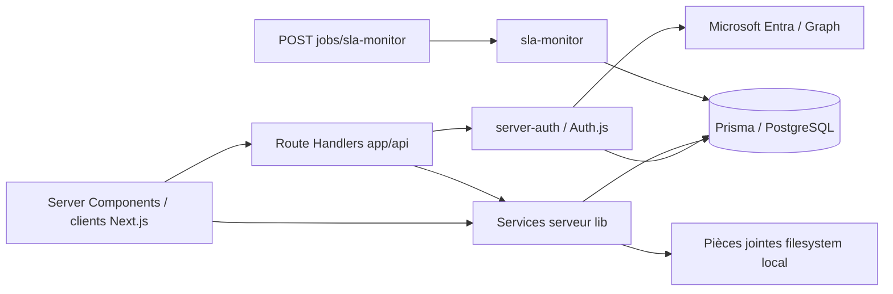

# Audit de scalabilité — phase 0 avant codage

**Projet :** 1TASK  
**Date :** 14 septembre 2026  
**Périmètre :** Next.js 16, TypeScript, Prisma, PostgreSQL, Auth.js/Entra ID  
**Nature :** audit statique du dépôt ; aucune modification runtime, Prisma ou SQL dans cette phase

## 1. Synthèse exécutive

Le dépôt possède déjà plusieurs fondations utiles : pagination bornée des tickets, projection partielle des relations, index composites sur les principaux filtres de `Ticket`, traitement SLA par lots, notifications groupées dans certains parcours et contrôles d'accès centralisés. Il n'est donc ni sûr ni utile de remplacer le service ticket ou le modèle Prisma en bloc.

Les principaux risques pour une charge multipliée par dix sont :

1. le moniteur SLA exécute plusieurs lectures et écritures **par ticket, métrique, seuil et destinataire** ;
2. la recherche ticket utilise trois `contains` insensibles à la casse, donc des motifs `%terme%` non couverts par les index B-tree ;
3. les listes ticket utilisent une pagination par offset et recalculent un `count` exact à chaque page ;
4. le reporting lance six agrégations distinctes sur le même périmètre ;
5. plusieurs listes administration/portefeuille/actifs chargent des collections sans pagination ;
6. le détail d'un ticket charge les historiques sans limite et effectue trois lectures du même ticket pour protéger l'autorisation ;
7. aucun cache distribué, outbox durable ou test de performance exécutable n'est présent.

**Conclusion :** commencer par l'observabilité et les plans `EXPLAIN`, puis livrer quatre changements atomiques : projection de liste, pagination curseur, recherche FTS et batch SLA. Redis et l'outbox viennent seulement après mesure. Le sharding n'est pas justifié à ce stade.

## 2. Méthode et limites

### Analysé

- structure `app/`, `lib/`, `prisma/`, `tests/` et documentation d'architecture ;
- les modèles et index du `schema.prisma`, ainsi que les 18 migrations existantes ;
- toutes les occurrences statiques de `findMany`, `include`, `count`, `groupBy`, `aggregate`, `$transaction` et `$queryRaw` dans `app/` et `lib/` ;
- routes tickets, recherche, exports, catalogue, notifications, administration, production et job SLA ;
- services ticket, autorisation, reporting, notifications, audit, connaissances, production, organisation et workflow ;
- tests de contrats de performance existants.

### Non disponible dans le dépôt

Il n'y a ni statistiques `pg_stat_statements`, ni plans `EXPLAIN (ANALYZE, BUFFERS)`, ni cardinalités de production, ni APM, ni métriques CPU/IOPS/verrous/connexions, ni distribution réelle des routes. Par conséquent, « scan complet » ou « requête lente » sont des **risques statiques à confirmer**, pas des faits observés. Aucun index ne doit être ajouté sur la seule base de cet audit : chaque proposition exige un plan de requête sur une copie représentative.

### Barème

| Niveau | Définition |
|---|---|
| **P0 critique** | risque d'indisponibilité, de perte, de doublon ou d'explosion de charge sur un parcours automatique |
| **P1 urgent** | limite probable avant 10× sur un parcours utilisateur ou une table centrale |
| **P2 important** | dérive progressive de latence/coût ou dette qui complique l'exploitation |
| **P3 optimisation** | gain ciblé, faible urgence ou cardinalité naturellement bornée |

## 3. Cartographie de l'architecture backend



| Zone | Responsabilité observée | Remarque de capacité |
|---|---|---|
| `app/api/**/route.ts` | authentification, validation Zod, sérialisation HTTP | routes dynamiques ; pas de politique cache HTTP centrale |
| `lib/server-auth.ts` | recharge le contexte utilisateur, rôles, permissions, scopes et équipes | graphe relationnel riche rechargé au début des opérations |
| `lib/ticket-service.ts` | création, visibilité, listes, détail, workflow, affectation, fichiers | service central de plus de 2 400 lignes ; nombreuses transactions sûres mais chemins chauds couplés |
| `lib/sla-monitor.ts` | balayage des tickets et émissions SLA | pagination curseur existante, mais fan-out N+1 interne |
| `lib/reporting-service.ts` | indicateurs tickets et SLA | six requêtes d'agrégat simultanées par affichage/export |
| `lib/notifications.ts` | préférences et création unitaire/groupée | `createMany` existe, mais n'est pas utilisé par le moniteur SLA |
| `lib/production-service.ts` | clients, dossiers, missions, actifs, worklogs | plusieurs listes non bornées et recherches `contains` |
| PostgreSQL | source de vérité transactionnelle et sessions | pas de réplica/cache/outbox dans le code audité |
| filesystem local | stockage actuel des pièces jointes | incompatible avec plusieurs instances sans volume partagé ; sujet de disponibilité, pas de SQL |

## 4. Inventaire PostgreSQL et migrations

### Index `Ticket` déjà présents

| Besoin demandé | Couverture actuelle | Décision d'audit |
|---|---|---|
| `status` + SLA première réponse | `(status, firstResponseDueAt)` | conserver ; migration déjà présente |
| `status` + SLA résolution | `(status, resolutionDueAt)` | conserver |
| `assignedTo` + statut + récence | `(assignedToId, status, updatedAt)` | conserver |
| file + statut + priorité + récence | `(queueId, status, priority, updatedAt)` | conserver |
| demandeur + statut + récence | `(requesterId, status, updatedAt)` | conserver |
| département source + création | `(sourceDepartmentId, createdAt)` | conserver |
| `createdAt` seul | absent | ne pas ajouter sans requête/plan prouvant le besoin |
| `updatedAt` seul | absent | candidat pour tri global, à confirmer par `EXPLAIN` |

La migration `20260903090000_lot6_query_indexes` ajoute les chronologies Worklog/Notification, et `20260903120000_lot7_sla_monitor_index` ajoute l'index SLA de première réponse. Le schéma reflète ces migrations. Les recréer produirait un doublon : toute future migration doit porter un nouveau nom d'index et être comparée à `pg_indexes` avant application.

### Risques de forme des prédicats

- Le moniteur combine `status NOT IN`, `slaPausedAt IS NULL`, deux branches `OR`, champs de réponse/résolution nuls et un ordre par `id`. Les index actuels ne garantissent pas qu'un seul parcours ordonné soit efficace.
- La liste ajoute un grand `OR` de visibilité et parfois des relations `queue.departmentId`, puis trie sur `updatedAt/id`, `createdAt/id` ou `status/updatedAt/id`. Un index universel serait volumineux et rarement optimal.
- La recherche `%terme%` sur `description` ne peut pas exploiter un B-tree ordinaire ; un index GIN FTS ciblé est justifié après validation linguistique.
- Les champs `metadata` JSON des événements SLA sont relus puis filtrés en JavaScript. Aucun invariant unique en base ne garantit actuellement l'idempotence `(ticket, eventType, metric, threshold)`.

## 5. Tableau complet des corrections prioritaires

| Fichier | Fonction | Problème observé | Impact à 10× | Correction proposée | Priorité |
|---|---|---|---|---|---|
| `lib/sla-monitor.ts` | `runSlaMonitor` / `emitSlaEvent` | boucles ticket × métrique × seuil ; transaction série par alerte | amplification des connexions, verrous et latence cron | précalculer les alertes du lot puis écrire events/audits/notifications par lots | **P0** |
| `lib/sla-monitor.ts` | `escalationRecipients` | recharge workers et affectations de rôles pour chaque alerte | N+1 majeur, répété pour une même file/rôle | précharger une fois par lot les destinataires par file/département/rôle et utiliser des maps | **P0** |
| `lib/sla-monitor.ts` + `prisma/schema.prisma` | idempotence alerte SLA | déduplication via lecture de tous les metadata, transaction Serializable et retry ; pas de contrainte unique métier | courses, contention ou doublons si plusieurs jobs | ajouter une clé d'idempotence matérialisée/unique par migration additive ; `createMany(skipDuplicates)` | **P0** |
| `lib/ticket-service.ts` | `buildTicketListWhere` | trois `contains mode: insensitive`, dont `description` texte | scans coûteux et temps de recherche croissant avec la table | migration SQL additive : expression/colonne `tsvector`, index GIN, requête paramétrée `plainto_tsquery`; conserver recherche exacte/préfixe de référence | **P1** |
| `lib/ticket-service.ts` | `ticketListInclude` | la liste charge manager, équipes, département source, catalogue, dossier/client et mission au-delà du contrat minimal demandé | payload, jointures et allocation Node inutiles | introduire `ticketListSelect` strict : id, reference, title, status, priority, assignedTo, queue, requester, createdAt, updatedAt, plus seuls champs SLA indispensables | **P1** |
| `lib/ticket-service.ts` | `listVisibleTicketsPageInternal` | pagination `skip`/offset et `count` exact sur chaque page | latence croissante sur pages profondes, double travail DB | curseur `(tri, id)`, `take + 1`, `nextCursor`; rendre le total optionnel ou calculé séparément | **P1** |
| `lib/ticket-service.ts` | `getOperationalTicketSummary` | six `count` partageant le même périmètre | six parcours/pressions pool par dashboard | une agrégation SQL conditionnelle paramétrée, en conservant exactement le prédicat de visibilité | **P1** |
| `lib/reporting-service.ts` | `getReportingSummary` | cinq `count` + un `groupBy` par appel | six requêtes lourdes ; export les réexécute | requête agrégée conditionnelle ; ensuite cache court cloisonné par empreinte de scope | **P1** |
| `lib/ticket-service.ts` | `getTicketForViewerInternal` | historiques messages/assignments/events sans `take`; ticket lu trois fois + deux agrégats worklog | fiche de vieux ticket non bornée, payload et requêtes croissants | paginer chaque historique ; projection d'accès minimale ; conserver le recheck de sécurité ou utiliser une lecture transactionnelle cohérente | **P1** |
| `lib/server-auth.ts` | `requireCurrentActor` | un service appelé après une route déjà authentifiée recharge un contexte relationnel riche ; cache React dépend du contexte Next | coût DB fixe sur tous les parcours et risque de lectures répétées hors même cache de rendu | mesurer le nombre de chargements ; cache request-scoped explicite, jamais inter-utilisateur ; invalider sur mutation de permissions | **P1** |
| `lib/production-service.ts` | `listDossiersForViewer` | liste non paginée avec toutes les missions et leurs départements | explosion lignes/jointures/payload | pagination dossiers + compteur/résumé ; relations complètes uniquement au détail | **P1** |
| `lib/production-service.ts` | `listAssetsForViewer` | liste non paginée et recherche sur trois `contains` | scan et payload non bornés | pagination curseur ; recherche préfixe/trigram/FTS selon besoin mesuré | **P1** |
| `lib/admin-service.ts` | `getAdminConfigurationInternal` | utilisateurs, équipes/membres et catalogues entiers chargés sans pagination | console admin peut saturer mémoire/DB à grande organisation | endpoints/sections paginés ; sélections minimales ; recherche serveur | **P1** |
| `lib/ticket-service.ts` | stockage de pièces jointes | `node:fs` et chemin local dans une application appelée à scaler horizontalement | fichier absent sur une autre instance, disque éphémère | abstraction de stockage objet, migration non destructive, lecture fallback temporaire | **P1** |
| `lib/ticket-service.ts` | `visibleTicketWhere` / `buildTicketListWhere` | membres d'équipe chargés une fois pour le scope puis potentiellement une seconde fois pour `scope=team` | travail redondant et grands tableaux `IN` | réutiliser les membres actifs request-scoped ; comparer avec un `EXISTS` SQL | **P2** |
| `lib/ticket-service.ts` | `chooseAutoAssignee` | charge tous les membres puis `groupBy` des tickets actifs au moment de chaque création | contention et latence de création sur grosses files | projection minimale d'agents disponibles ; compteur de charge transactionnel/snapshot seulement après mesure | **P2** |
| `lib/notifications.ts` | `createInAppNotification` | lecture de préférence puis création pour chaque notification unitaire | deux requêtes par notification sur chemins fréquents | utiliser systématiquement le chemin groupé ; cache court des préférences avec clé utilisateur/type/canal | **P2** |
| `lib/notification-service.ts` | `listUserNotifications` | `take` borné mais sans curseur | impossible de parcourir efficacement l'historique ; pages futures à offset probable | curseur `(createdAt,id)` et projection explicite | **P2** |
| `lib/production-service.ts` | `listClientAccounts`, `listMissionsForViewer`, `getClientForViewer`, `listMissionWorklogs` | plusieurs listes restent non bornées si `take` absent ; relations imbriquées | croissance progressive de payload et mémoire | rendre la limite obligatoire avec curseur ; séparer liste et détail | **P2** |
| `lib/knowledge-service.ts` | `listKnowledgeArticles` | liste non paginée et `contains` sur titre/corps | scan texte et payload croissants | pagination + FTS dédié si cardinalité le justifie | **P2** |
| `lib/audit-service.ts` | `listAuditLogsForViewerPage` | offset + `count` + six recherches `contains` | audit volumineux : page profonde et recherche lentes | curseur ; filtres structurés ; stratégie FTS/trigram validée | **P2** |
| `app/api/catalog/route.ts` | `GET` | catalogue actif entier renvoyé sans cache | lectures répétées de données peu volatiles | ETag/cache privé ou Redis par version ; invalidation lors des mutations admin | **P2** |
| `app/api/departments/route.ts` | `GET` | liste entière sans cache | requêtes répétées mais faible cardinalité probable | cache versionné court ; conserver projection actuelle | **P3** |
| `lib/workflow-service.ts` | `listWorkflowDefinitions` | toutes les versions sans pagination | charge si historique de versions important | ne retourner que versions actives/récentes ou paginer | **P3** |
| `lib/performance.ts` | `measureServerOperation` | seul log des opérations > 750 ms, sans route, percentile ni SQL | diagnostic impossible avant incident | OpenTelemetry + RED/USE + `pg_stat_statements`, sans PII | **P0** |
| `tests/*performance*` | tests de performance | contrats textuels seulement ; aucun générateur de charge ni seuil p95/p99 | aucune preuve de capacité ou non-régression 10× | suite k6/Artillery dédiée et environnement volumétrique | **P0** |
| nouveau composant | cache Redis | absent ; candidats non inventoriés par fréquence réelle | DB sert toutes les lectures répétitives | commencer catalogue/reporting ; cache-aside, TTL jitter, single-flight, clé scope/version | **P2** |
| nouveau modèle/migration additive | outbox | notifications post-commit via `after()` et pas de livraison durable | perte possible si process termine après commit ; pas de replay/DLQ | outbox dans transaction, worker idempotent, retry/DLQ ; migrer flux par flux | **P1** |

## 6. Analyse ciblée du service ticket

### Ce qui doit être conservé

- les prédicats de visibilité serveur et le rechargement de l'acteur avant mutation ;
- la limite actuelle de page à 100 et le tri déterministe avec `id` en second critère ;
- le détail riche seulement après autorisation ;
- la clé d'idempotence de création et la transaction de création ;
- les projections de relations déjà partielles plutôt qu'un `include: true` global.

### Contrat proposé pour `ticketListSelect`

La correction future ne doit pas reprendre le `ticketListInclude` actuel. Le contrat minimal est :

```ts
const ticketListSelect = {
  id: true,
  reference: true,
  title: true,
  status: true,
  priority: true,
  assignedTo: { select: { id: true, name: true } },
  queue: { select: { id: true, name: true } },
  requester: { select: { id: true, name: true } },
  createdAt: true,
  updatedAt: true,
  // À conserver uniquement si l'état SLA reste calculé côté application :
  firstResponseDueAt: true,
  firstRespondedAt: true,
  resolutionDueAt: true,
  resolvedAt: true,
  slaPausedAt: true,
  totalPausedMinutes: true,
} satisfies Prisma.TicketSelect;
```

Avant suppression des champs actuels (`sourceDepartment`, catalogue, dossier, mission, manager, teams), il faut relever leurs consommateurs TypeScript et adapter une seule vue par commit. Le compilateur doit garantir qu'aucun contrat UI/API n'est cassé.

### Recherche full text proposée

Livrer sans remplacer le modèle `Ticket` :

1. migration SQL additive avec une colonne générée `search_vector` ou un index GIN d'expression pondérée ;
2. configuration linguistique explicitement choisie (`french` si les contenus sont majoritairement français, sinon `simple`) ;
3. requête paramétrée combinant visibilité et `plainto_tsquery` ;
4. branche exacte/préfixe pour `reference`, qui n'est pas du langage naturel ;
5. tests accentuation, mots vides, apostrophes, référence, titre, description et cloisonnement ;
6. construction de l'index avec stratégie compatible production (`CREATE INDEX CONCURRENTLY`, hors transaction si l'outil de déploiement l'exige).

Un `$queryRaw` ne doit jamais interpoler le texte ou des identifiants de scope. La difficulté principale n'est pas le GIN, mais la conservation exacte de `visibleTicketWhere`; une implémentation en deux temps qui récupère trop d'identifiants serait elle-même un risque de performance.

## 7. Plan de batch du moniteur SLA

### Avant (constat)

```text
lot de 500 tickets
  └─ pour chaque ticket / métrique / seuil atteint
       └─ transaction Serializable
          ├─ lecture des anciens events + filtre JSON en Node
          ├─ lecture des membres de file
          ├─ lecture des affectations par rôle/règle
          ├─ création event
          ├─ création audit
          └─ pour chaque destinataire : préférence + notification
```

### Après (correction proposée, non implémentée)

```text
lot borné de tickets éligibles
  ├─ préchargement groupé : events existants, files/membres, rôles, préférences
  ├─ calcul pur en mémoire des alertes manquantes
  └─ transaction courte
      ├─ createMany events (contrainte idempotente, skipDuplicates)
      ├─ createMany audits
      └─ createMany notifications correspondant aux events effectivement acquis
```

Il faut traiter le lien event→notification avec prudence : si `skipDuplicates` ne retourne pas les lignes insérées selon la version/capacité Prisma utilisée, acquérir d'abord les clés idempotentes ou relire les identifiants dans la transaction. La sécurité, la pagination curseur et une taille de lot configurable (commencer à 100, mesurer, plafonner) sont obligatoires.

## 8. Reporting et cache

### Reporting

La requête agrégée future doit produire en un parcours : total, fermés, SLA en retard, première réponse dépassée, résolution dépassée et comptes par statut. Le prédicat d'autorisation doit rester identique à celui des tickets. Avant SQL brut, ajouter des tests croisant rôles global/département/file/équipe/liste nominative et confidentialité.

### Candidats cache, après instrumentation

| Donnée | Clé minimale | TTL de départ | Invalidation | Risque |
|---|---|---:|---|---|
| catalogue actif | version organisation/département | 5 min + jitter | mutation catalogue/file/SLA | service retiré servi brièvement |
| départements actifs | version globale | 10 min + jitter | mutation département | faible cardinalité, gain peut être nul |
| reporting | empreinte des scopes et filtres | 30–60 s + jitter | TTL d'abord, puis event ciblé | fuite si clé omet un scope |
| permissions calculées | userId + version des rôles/scopes | 30–120 s | toute mutation user/rôle/scope/équipe | autorisation obsolète |
| compteur non lu | userId | 10–30 s | création/lecture notification | compteur brièvement obsolète |

Le cache doit être cache-aside, borné, observable (hit/miss/eviction), avec TTL jitteré, single-flight et fallback PostgreSQL. Aucun objet ticket confidentiel ne constitue un premier candidat. Une panne Redis ne doit jamais accorder un droit ni empêcher une mutation métier.

## 9. Outbox et traitements asynchrones

Ordre d'extraction recommandé : e-mail, exports, notifications non critiques, snapshots reporting. Les mutations de workflow, audits append-only et contrôles d'accès restent synchrones.

Le modèle futur d'outbox sera ajouté sans modifier destructivement les tables existantes : identifiant global, type, agrégat/id, payload versionné, clé d'idempotence unique, `occurredAt`, `availableAt`, `attempts`, `lockedAt`, `processedAt`, `lastError`. Un worker utilise `FOR UPDATE SKIP LOCKED`, bail expirant, backoff jitteré et table de dead letters ou statut terminal. Le replay est filtrable, audité et idempotent côté consommateur.

Le `after()` utilisé après création de ticket améliore la latence utilisateur mais ne garantit pas à lui seul la livraison après crash. La première migration outbox doit donc cibler ce flux, sous feature flag, avec double lecture temporaire mais sans double publication.

## 10. Plan de tests de performance

| Scénario | Profil | Durée | Critères initiaux |
|---|---|---:|---|
| normal | charge de production mesurée | 30 min | p95 lecture < 300 ms, mutation < 500 ms, 5xx < 0,1 % |
| pic | 10× charge soutenue visée | 15 min | p99 lecture < 800 ms, mutation < 1 200 ms |
| spike | 0→10× puis retour | 2 min + 10 min | pas d'effondrement pool, récupération < 5 min |
| soak | charge cible soutenue | 8 h | pas de fuite heap/connexions, latence stable |

Parcours pondérés : création idempotente, liste et recherche ticket, détail, dashboard/reporting, lecture notifications et exécution SLA sur données préparées. Capturer API p95/p99/erreurs et PostgreSQL CPU, connexions, pool wait, locks, IOPS, cache hit, top SQL et plans. Les tests doivent charger une base au volume cible, avec plusieurs scopes d'autorisation, sans utiliser de données personnelles de production.

## 11. Séquencement atomique proposé

Chaque item ci-dessous est une livraison autonome. La suivante ne commence qu'après tests fonctionnels, `npx prisma validate`, `npm run typecheck` et `npm run build` au vert.

1. **P0-OBS** — instrumentation Prisma/HTTP et baseline `pg_stat_statements`; aucun changement de requête.
2. **P1-LIST-SELECT** — introduire `ticketListSelect`, adapter ses consommateurs et mesurer le payload.
3. **P1-LIST-CURSOR** — ajouter un contrat curseur compatible, conserver temporairement l'ancien contrat.
4. **P1-FTS** — migration GIN additive, backfill/construction sûre, chemin de recherche sous feature flag.
5. **P0-SLA-IDEMPOTENCE** — contrainte/clef idempotente additive sans encore changer le batch.
6. **P0-SLA-BATCH-READ** — grouper les lectures destinataires/events, sorties fonctionnelles inchangées.
7. **P0-SLA-BATCH-WRITE** — `createMany` events/audits/notifications, canary et comparaison.
8. **P1-REPORTING** — agrégat unique avec tests de cloisonnement ; comparer plans/coût.
9. **P1-UNBOUNDED-LISTS** — une liste par commit : dossiers, actifs, admin, missions, audit.
10. **P2-REDIS** — catalogue puis reporting, jamais les permissions en premier.
11. **P1-OUTBOX** — notifications de création, puis e-mail/exports ; worker et replay.
12. **PERF-10X** — normal/pic/spike/soak et validation des seuils avant changement d'infrastructure.

## 12. Garde-fous de migration et critères de sortie de phase 0

Avant toute migration d'index :

```sql
SELECT schemaname, tablename, indexname, indexdef
FROM pg_indexes
WHERE schemaname = 'public' AND tablename IN ('Ticket', 'TicketEvent', 'Notification')
ORDER BY tablename, indexname;
```

Puis exécuter `EXPLAIN (ANALYZE, BUFFERS, WAL)` sur un clone anonymisé, comparer temps, buffers, lignes estimées/réelles et coût d'écriture. Utiliser une migration additive, nom unique, création concurrente lorsque nécessaire, et plan de rollback par `DROP INDEX CONCURRENTLY` seulement après retour au chemin de code précédent.

La phase 0 est terminée lorsque :

- les top requêtes et cardinalités sont mesurés sur 14 jours ;
- les plans des listes, recherche, SLA et reporting sont archivés ;
- la capacité sûre d'une instance et du pool Prisma est connue ;
- les seuils p95/p99/erreur sont acceptés ;
- les lots atomiques ci-dessus ont un responsable, un rollback et une fenêtre ;
- **aucune** modification destructive ou remplacement complet de modèle/fichier n'est planifié.

## 13. Format obligatoire des futures corrections

Ce rapport ne contient aucune correction de code. Pour chaque future livraison, le compte rendu utilisera :

1. fichier modifié ;
2. extrait avant ;
3. extrait après ;
4. explication technique ;
5. impact attendu et mesure avant/après ;
6. risque, feature flag et rollback ;
7. commandes de validation, obligatoirement :
   - `npx prisma validate` ;
   - `npm run typecheck` ;
   - `npm run build` ;
   - tests unitaires/intégration/performance ciblés.

