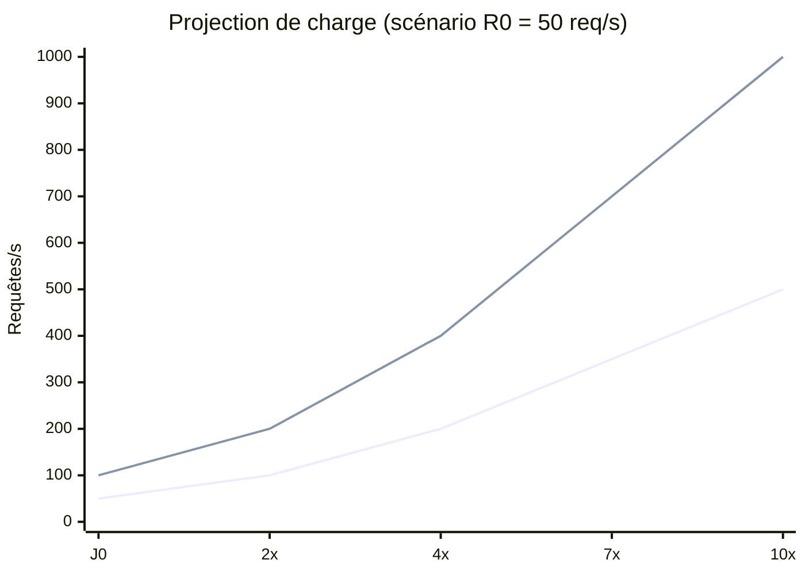
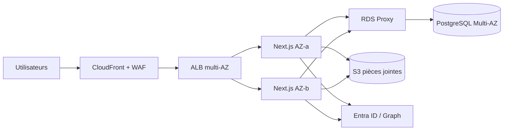
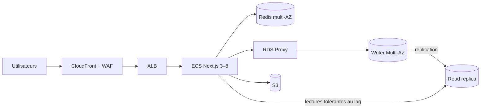
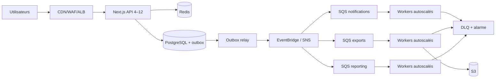
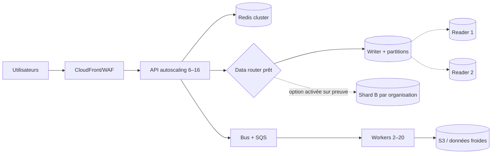

# Plan progressif de scalabilité — objectif 10×

**Périmètre :** application interne 1TASK (Next.js 16, Auth.js/Entra ID, Prisma et PostgreSQL)  
**Horizon de planification :** 12 à 18 mois  
**Statut :** proposition à valider par une campagne de mesure en production  
**Devise et date de référence :** USD hors taxes, septembre 2026

## 1. Décision et principes directeurs

La cible n'est pas une migration « big bang ». Le plan conserve le monolithe modulaire Next.js tant qu'il tient ses SLO, rend d'abord les instances sans état, traite la base et les lectures coûteuses, puis extrait uniquement les traitements asynchrones qui ont une valeur mesurée. Le sharding est une **option de dernier recours**, préparée mais non déclenchée avant preuve que le partitionnement, les index, le cache et les réplicas ne suffisent plus.

Les choix ci-dessous prennent AWS comme base de chiffrage afin de rendre les ordres de grandeur comparables. Les équivalents sont Cloud Run/GKE, Cloud SQL, Memorystore, Pub/Sub et Cloud CDN sur GCP, ou Container Apps/AKS, Azure Database for PostgreSQL, Azure Cache for Redis, Service Bus et Front Door sur Azure. Le fournisseur final doit être choisi après comparaison du coût total, des compétences et des engagements existants.

### Résultat attendu

| Indicateur de service | Situation à mesurer (J0) | Cible à 10× |
|---|---:|---:|
| Charge soutenue | `R0` req/s | `10 × R0` req/s pendant 60 min |
| Pic absorbé | `P0` req/s | `10 × P0` req/s pendant 15 min |
| Latence lecture API | baseline à instrumenter | p95 ≤ 300 ms, p99 ≤ 800 ms |
| Latence mutation API | baseline à instrumenter | p95 ≤ 500 ms, p99 ≤ 1 200 ms |
| Pages interactives | baseline RUM à instrumenter | LCP p75 ≤ 2,5 s, INP p75 ≤ 200 ms |
| Disponibilité | baseline à calculer | ≥ 99,9 % mensuel (hors maintenance annoncée) |
| Erreurs serveur | baseline à calculer | HTTP 5xx < 0,1 % sur 5 min et sur 30 jours |
| Perte de données / reprise | non formalisé | RPO ≤ 5 min, RTO ≤ 30 min |

`R0`, `P0`, `U0` (utilisateurs actifs simultanés) et `D0` (volume de données) sont des mesures, pas des estimations. Aucun achat du palier 2 ou supérieur ne doit être approuvé sans les renseigner.

## 2. Hypothèses et modèle de capacité

Pour donner un budget exploitable avant la mesure J0, le scénario de référence suppose `R0 = 50 req/s` soutenues, `P0 = 100 req/s`, `U0 = 500` sessions simultanées, une lecture/écriture de 80/20, 500 Go de PostgreSQL et 5 To/mois sortant via le CDN. Les coûts sont des **ordres de grandeur arrondis** en région AWS us-east-1, fonctionnement 730 h/mois, hors support Enterprise, taxes, remises contractuelles, main-d'œuvre et coûts Entra/Microsoft Graph. Une variation de ±30 % est normale avant un calculateur fournisseur et un test réel.

Les dimensions se recalculent ainsi :

- `RPS_palier = multiplicateur × R0` et `pic = multiplicateur × P0` ;
- `instances_min = ceil(RPS_cible / RPS_instance_sûr)` avec `RPS_instance_sûr` mesuré à ≤ 60 % CPU ;
- `connexions_DB = instances_max × pool_par_instance`, toujours inférieur à 80 % de la limite du proxy/base ;
- `débit_écriture = RPS × 20 % × écritures_par_mutation` ;
- `budget_mensuel = compute + DB + cache + messages + stockage + transfert + observabilité + sauvegardes`.

| Palier | Sessions simultanées | RPS soutenues | Pic RPS | Données indicatives | Marge de capacité obligatoire |
|---|---:|---:|---:|---:|---:|
| J0 / 1× | 500 | 50 | 100 | 500 Go | mesure seulement |
| P1 / 2× | 1 000 | 100 | 200 | 0,8 To | 30 % au-dessus du pic testé |
| P2 / 4× | 2 000 | 200 | 400 | 1,5 To | 30 % |
| P3 / 7× | 3 500 | 350 | 700 | 2,5 To | 30 % |
| P4 / 10× | 5 000 | 500 | 1 000 | 4 To | 30 % |

## 3. Phase 0 — mesurer et enlever les goulots (semaines 1 à 3)

### 3.1 Instrumentation minimale

1. Propager un `trace_id` de CloudFront/ALB jusqu'à Next.js, Prisma et aux appels Microsoft Graph ; adopter OpenTelemetry (traces, métriques et logs structurés).
2. Mesurer RED par route : débit, taux d'erreur, durée p50/p95/p99 ; mesurer USE par ressource : utilisation, saturation et erreurs.
3. Activer `pg_stat_statements`, Performance Insights et les journaux de requêtes lentes (seuil initial 250 ms), avec requêtes normalisées et sans données personnelles.
4. Ajouter des spans Prisma par opération et compteur du nombre de requêtes SQL par requête HTTP pour détecter les N+1. Le chronomètre applicatif existant à 750 ms reste une alerte de dernier niveau, non un dispositif APM.
5. Suivre ALB `RequestCount`, `TargetResponseTime`, `HTTPCode_Target_5XX`; ECS CPU/mémoire/redémarrages; PostgreSQL CPU, connexions, verrous, IOPS, latence disque, cache-hit, lag; Redis mémoire, evictions et hit ratio; files profondeur et âge du plus vieux message.
6. Installer du RUM sur LCP/INP/CLS, et trois tests synthétiques : connexion, liste/recherche, création et commentaire d'un ticket.

### 3.2 Méthode de profiling

| Analyse | Outil / donnée | Signal de saturation | Action courte |
|---|---|---|---|
| Routes et rendu serveur | traces OTel + profiler Node en préproduction | event-loop p95 > 50 ms, CPU > 70 %, heap > 80 % | supprimer calculs bloquants, pagination bornée, streaming ciblé |
| SQL | `pg_stat_statements`, `EXPLAIN (ANALYZE, BUFFERS)` sur clone anonymisé | top 10 > 50 % du temps DB, scans séquentiels, p95 > 100 ms | index composé/partiel, requête et projection minimales |
| Connexions | métriques Prisma/proxy/Postgres | > 70 % en continu ou attente > 20 ms | RDS Proxy/PgBouncer, pool borné, timeout |
| I/O et verrous | Performance Insights | queue depth > 1 par vCPU, lock wait > 5 % | transactions courtes, batch, IOPS provisionnées |
| Dépendances | spans Entra/Graph/e-mail/stockage | p95 > 500 ms ou erreurs > 1 % | timeout, retry avec jitter, circuit breaker, file async |
| Frontend/réseau | RUM et CloudFront | cache hit < 80 % sur statique, LCP > 2,5 s | CDN, compression, optimisation bundle/image |

Livrables de sortie : tableau de bord J0 sur 14 jours représentatifs, top 20 des transactions par temps total, carte des dépendances, capacité sûre par instance, et rapport de test reproductible. Les données sensibles ne doivent jamais apparaître dans les traces.

### 3.3 Test de charge de référence

- Scénario pondé sur trafic réel : 55 % listes/recherches, 20 % consultation, 10 % création/commentaire, 10 % notifications, 5 % administration/reporting.
- Jeu de données au volume de production puis au volume du palier ; comptes et organisations multiples pour valider le cloisonnement.
- Ramp-up 20 min, plateau 60 min, pic 15 min, spike 2 min, puis soak 8 h ; injection depuis au moins deux zones.
- Les écritures portent une clé d'idempotence ; les retries sont plafonnés et jitterés. On vérifie les invariants : aucun doublon, historique append-only intact et aucun franchissement de permissions.
- Critère d'arrêt : erreurs > 2 %, p99 > 3 s pendant 5 min, CPU DB > 90 %, connexions > 90 % ou menace sur les données.

## 4. Architecture et plan par palier

### Palier 1 — stabiliser jusqu'à 2× (semaines 3 à 6)

Mettre deux tâches Next.js sans état dans deux AZ derrière un ALB. Les sessions persistent en PostgreSQL/Redis, jamais en mémoire locale. ECS target-tracking garde 2 tâches au minimum, passe à 4 sur CPU 60 % ou ALB request/task, scale-out court (60 s), scale-in prudent (10 min). Les déploiements sont rolling avec `minHealthyPercent=100`.

Optimiser les requêtes mesurées, imposer pagination par curseur et limites d'export, servir JS/CSS/images via CloudFront, compresser, et mettre les pièces jointes dans S3 avec URL signée. RDS PostgreSQL devient Multi-AZ, chiffré, sauvegardé et restauré lors d'un exercice mensuel. RDS Proxy ou PgBouncer absorbe les connexions des instances élastiques.

**Validation :** 200 RPS en pic dans le scénario de référence, SLO respectés, une tâche et une AZ applicative perdues sans interruption perceptible, restauration RPO/RTO prouvée.

### Palier 2 — distribuer les lectures jusqu'à 4× (mois 2 à 4)

Ajouter Redis multi-AZ pour les catalogues, permissions calculées, compteurs de notifications et résultats de reporting fréquents. Pattern cache-aside : TTL jitteré 30–300 s, clés versionnées avec organisation/périmètre, invalidation après commit. Ne jamais cacher une réponse sans inclure le contexte d'autorisation. Protection anti-stampede (single-flight/lock court) et repli DB en cas de panne cache.

Ajouter un reader PostgreSQL et router uniquement les lectures tolérant la cohérence éventuelle (reporting, catalogue, recherche). Toute lecture immédiate après mutation, permission, workflow ou audit reste sur le writer. Passer `replica_lag_seconds` dans le contexte et replier vers le writer si lag > 5 s. Les instances applicatives passent de 3 à 8 selon la charge.

**Validation :** pic 400 RPS, cache hit ≥ 80 % sur objets éligibles, au moins 40 % des lectures DB déchargées, lag p99 < 5 s, writer CPU p95 < 60 %, test de perte Redis sans violation fonctionnelle.

### Palier 3 — asynchronisme et découplage jusqu'à 7× (mois 4 à 7)

Sortir du chemin synchrone les e-mails, exports, indexation/recherche, calculs de reporting et notifications non critiques. La transaction métier écrit l'état et un **outbox event** dans la même transaction PostgreSQL. Un relay publie vers EventBridge/SNS puis SQS ; les workers acquittent après succès. Chaque consommateur a une table/clef d'idempotence, retry exponentiel avec jitter, maximum de tentatives et DLQ alarmée. Aucun dual-write base/bus.

Partitionner les plus grandes tables append-only (`AuditLog`, `TicketEvent`, notifications) par mois ou hash logique sans changer l'identité globale ; archiver les partitions froides vers S3. Construire index et partitions en ligne et vérifier les plans avant/après. Conserver le cœur transactionnel dans le monolithe modulaire : l'extraction en microservice n'est autorisée qu'avec propriétaire, SLO et cycle de charge distincts.

**Validation :** pic 700 RPS, p95 mutation < 500 ms, âge p95 des messages < 30 s et maximum < 5 min, DLQ nulle hors test, replay sans doublon, 8 h de soak sans croissance mémoire/connexions.

### Palier 4 — 10× et préparation du sharding (mois 7 à 12)

Dimensionner 6–16 tâches API et 2–20 workers sur la profondeur/l'âge des files, une classe DB mémoire optimisée, deux readers et Redis en cluster si la mesure le justifie. Ajouter des bulkheads par dépendance et quotas équitables par organisation : token bucket, réponse 429 + `Retry-After`, priorité aux mutations interactives devant exports/reporting.

Préparer le sharding sans l'activer : toutes les tables concernées portent une clé stable `organizationId`, les identifiants sont globalement uniques, aucune jointure inter-tenant n'est introduite, et un routeur de données est testé. Le shard map est fortement cohérent et audité. Les agrégats globaux passent par le pipeline événementiel, jamais par des jointures synchrones inter-shards.

**Activation du sharding uniquement si**, après optimisation : writer CPU ou IOPS > 70 % pendant 30 min à charge normale, p95 SQL > 100 ms, stockage/maintenance ne tient plus sa fenêtre, ou projection à six mois dépasse 70 % de la plus grande classe acceptable. Il faut en plus deux tests à 1,3× le pic cible et une analyse montrant que le scale-up/partitionnement coûte davantage sur 12 mois.

**Validation :** 1 000 RPS en pic et 500 RPS pendant 60 min, marge 30 %, objectifs de latence/erreur respectés, perte d'une AZ, bascule writer, coupure d'un reader, panne cache et replay de file tous exercés.

## 5. Budget mensuel indicatif

| Poste (USD/mois) | P1 2× | P2 4× | P3 7× | P4 10× |
|---|---:|---:|---:|---:|
| ECS/Fargate API + workers | 180 | 420 | 850 | 1 450 |
| ALB, NAT/VPC endpoints | 120 | 180 | 260 | 350 |
| PostgreSQL Multi-AZ + stockage/IO | 750 | 1 650 | 2 500 | 4 200 |
| Réplicas de lecture | 0 | 650 | 1 100 | 2 200 |
| RDS Proxy | 100 | 180 | 260 | 400 |
| Redis multi-AZ/cluster | 0 | 300 | 550 | 1 100 |
| S3, CloudFront, transfert | 450 | 750 | 1 200 | 1 850 |
| SQS/EventBridge | 0 | 30 | 150 | 300 |
| Observabilité, WAF, sauvegardes | 500 | 900 | 1 500 | 2 400 |
| **Total arrondi** | **2 100** | **5 100** | **8 400** | **14 250** |
| Fourchette de planification (±30 %) | 1 470–2 730 | 3 570–6 630 | 5 880–10 920 | 9 975–18 525 |

Le coût n'est pas linéaire : Multi-AZ, observabilité et réserve de capacité sont des coûts fixes de fiabilité. Après quatre semaines de charge stable, appliquer Savings Plans/instances réservées au socle minimal, Spot uniquement aux workers idempotents et interruptibles, lifecycle S3 sur données froides, échantillonnage adaptatif des traces et budgets/alertes à 80/100/120 %. Suivre `coût / 10 000 requêtes utiles` et `coût / ticket traité`, pas seulement la facture totale.

### Coûts ponctuels humains (hors tableau)

| Phase | Effort indicatif | Compétences |
|---|---:|---|
| Mesure + P1 | 6–10 semaines-personnes | SRE, backend, DBA, sécurité |
| P2 | 6–8 semaines-personnes | backend, DBA, performance |
| P3 | 10–16 semaines-personnes | plateforme, backend, QA |
| P4 hors sharding | 8–12 semaines-personnes | SRE, DBA, FinOps |
| Sharding si déclenché | 20–30 semaines-personnes | architecte, DBA, backend, migration |

## 6. Portes de passage et critères de déclenchement

On ne change pas de palier au premier pic. Une porte s'ouvre lorsqu'un seuil est franchi 3 fois sur 7 jours **ou** lorsque la prévision à 90 jours atteint 70 % de la capacité validée. Toute phase peut être avancée pour une exigence de disponibilité ou de conformité.

| Déclencheur mesuré | Évolution | Validation avant production | Retour arrière |
|---|---|---|---|
| App CPU p95 > 65 % 15 min ou ALB p95 dérive, DB saine | augmenter tâches/autoscaling | test à 1,3× prochain pic | revenir au min précédent |
| Writer CPU > 60 %, lectures > 60 %, cache-hit DB dégradé | cache + read replica | cohérence, lag et panne cache | feature flag vers writer/cache off |
| Connexions > 70 % ou attente > 20 ms | proxy/pool borné | spike + fuite de connexions | ancienne chaîne conservée |
| Tâches externes > 20 % de p95 ou timeout > 0,5 % | outbox + file + workers | replay/idempotence/DLQ | consommateur stoppé, outbox conservée |
| Table > 500 Go ou maintenance > fenêtre | partitionnement/archivage | clone volumétrique + restore | partitions attachées, lecture duale temporaire |
| Limites writer persistantes après P4 | sharding ciblé | migration canary d'un tenant, checksum, retour testé | reverse replication et shard map |

Chaque changement est sous feature flag lorsque possible, livré par canary 5 % → 25 % → 100 %, avec comparaison des SLI et arrêt automatique sur consommation excessive du budget d'erreur.

## 7. Matrice de validation par palier

| Contrôle | P1 | P2 | P3 | P4 |
|---|:---:|:---:|:---:|:---:|
| Charge soutenue + pic + spike | ✓ | ✓ | ✓ | ✓ |
| Soak 8 h |  | ✓ | ✓ | ✓ |
| Perte d'une tâche / autoscaling | ✓ | ✓ | ✓ | ✓ |
| Perte AZ et bascule PostgreSQL | ✓ |  | ✓ | ✓ |
| Cache indisponible / stampede |  | ✓ | ✓ | ✓ |
| Replica lag / repli writer |  | ✓ | ✓ | ✓ |
| Replay, poison message, DLQ |  |  | ✓ | ✓ |
| Restauration sauvegarde + RPO/RTO | ✓ | ✓ | ✓ | ✓ |
| Autorisations et confidentialité sous charge | ✓ | ✓ | ✓ | ✓ |
| Coût par 10 000 requêtes dans le budget | ✓ | ✓ | ✓ | ✓ |

La promotion exige zéro violation d'intégrité/sécurité, tous les SLO pendant le plateau, 30 % de marge, aucun leak de ressource sur le soak et un coût projeté dans la fourchette approuvée. Un simple test de moyenne ne suffit jamais : les percentiles et le budget d'erreur décident.

## 8. Exploitation, SLO et alertes

### SLO et budget d'erreur

Une disponibilité de 99,9 % autorise environ 43 min 49 s d'indisponibilité sur 30,44 jours. Les alertes multi-window évitent le bruit : page immédiate si burn rate ≥ 14,4× sur 5 min et 1 h ; ticket prioritaire si ≥ 6× sur 30 min et 6 h. Geler les changements non correctifs après consommation de 50 % du budget, et dédier la capacité à la fiabilité après 100 %.

### Tableaux de bord obligatoires

- **Service :** RPS, p50/p95/p99 par route, 4xx/5xx, saturation event-loop, déploiements annotés.
- **Données :** top SQL, CPU/IOPS/verrous/connexions, tailles/index bloat, lag, cache hits/evictions.
- **Async :** published/processed/failed, profondeur, âge maximum, retries, DLQ, temps bout-en-bout.
- **Expérience :** Core Web Vitals p75, parcours synthétiques, temps de recherche/création.
- **FinOps :** coût/jour par composant et environnement, unit economics, forecast, anomalies.

### Runbooks et exercices

Documenter : rollback applicatif, bascule DB, cache vide/indisponible, saturation pool, replica lag, DLQ/replay, fournisseur d'identité indisponible et restauration. Faire un game day trimestriel et une restauration mensuelle. La sauvegarde n'est considérée valide qu'après restauration et contrôle d'intégrité.

## 9. Risques et arbitrages

| Risque | Impact | Réduction |
|---|---|---|
| Cache de permissions incorrect | fuite inter-périmètres | clé incluant tenant/utilisateur/version, TTL court, tests négatifs |
| Lecture stale après mutation | workflow incohérent | lecture writer sur chemins critiques et read-your-writes |
| Tempête de retries | panne amplifiée | budgets retry, backoff jitter, circuit breakers, admission control |
| Autoscaling app sature la DB | indisponibilité DB | max tasks lié au pool, proxy, load shedding |
| Événements dupliqués/perdus | notification ou export incorrect | outbox, consumers idempotents, reconciliation |
| Sharding prématuré | coût et complexité | seuils objectifs, partitions/readers/cache d'abord |
| Observabilité trop coûteuse | dérive budget | sampling adaptatif, rétention par criticité, logs structurés |
| Dépendance fournisseur | migration coûteuse | domaine portable, IaC, PostgreSQL/Redis/S3 APIs isolées ; accepter les services managés là où le gain opérationnel domine |

## 10. Feuille de route d'exécution

1. **S1–S2 :** instrumenter, définir les SLI, capturer J0, construire les scripts de charge et le jeu de données.
2. **S3 :** corriger top SQL/N+1, bornes et pagination ; mesurer la capacité sûre d'une instance.
3. **S4–S6 :** P1 multi-AZ, stateless, CDN, proxy, sauvegarde/restauration ; gate 2×.
4. **M2–M4 :** P2 Redis puis replica derrière feature flags ; gate 4×.
5. **M4–M7 :** P3 outbox et workers, un flux à la fois (e-mail, exports, reporting), partitions ; gate 7×.
6. **M7–M12 :** P4 quotas/bulkheads, deux readers si justifiés, préparation du routage tenant ; gate 10×.
7. **Continu :** revue capacité/FinOps mensuelle, chaos trimestriel, test de restauration mensuel et recalibrage des prévisions.

### Responsabilités

Le Product Owner fixe les parcours critiques et accepte les SLO ; le lead SRE possède capacité, alertes et exercices ; le DBA possède plans SQL, sauvegarde, réplication et partitions ; le lead backend possède idempotence, cache et outbox ; la sécurité valide cloisonnement, chiffrement et traces ; FinOps valide le coût unitaire à chaque porte. Chaque palier a un responsable nommé et une date de revue.

## 11. Checklist de go/no-go 10×

- [ ] `R0`, `P0`, `U0`, `D0` et croissance à 90 jours sont issus de 14 jours de production.
- [ ] Le test 10× reproductible respecte p95/p99, erreurs, intégrité et marge de 30 %.
- [ ] Le basculement multi-AZ, la restauration et le RPO/RTO ont des preuves horodatées.
- [ ] Les chemins cache/replica ont des replis testés et ne contournent aucune autorisation.
- [ ] L'outbox et chaque consommateur prouvent idempotence, replay et traitement de DLQ.
- [ ] Les limites de connexions et d'autoscaling protègent PostgreSQL.
- [ ] Les budgets fournisseur et coûts unitaires ont un propriétaire et des alertes.
- [ ] Le runbook d'incident, le rollback et les astreintes sont validés.
- [ ] Le sharding reste désactivé tant que ses seuils objectifs ne sont pas atteints.

